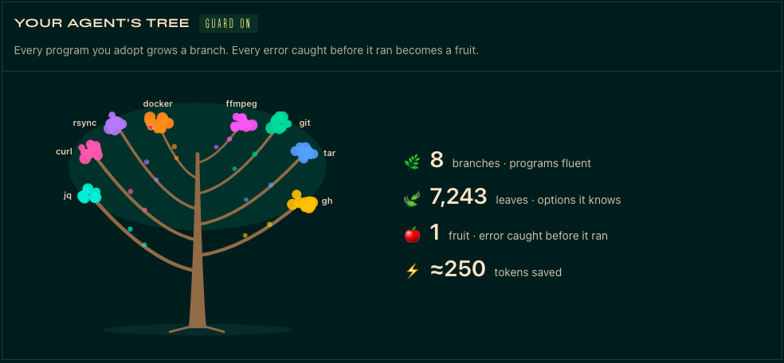

# fluent

**Your agent becomes fluent in any program.**

Hermes already checks the code it writes. **fluent checks the shell commands it runs**,
against the real `--help` and `man` pages of the program installed on *your* machine,
before they run.



```
agent> ffmpeg -y -i in.mp4 -c:v libx264 --crf 28 out.mp4
🛡️ fluent caught `--crf` in ffmpeg → `-crf`
agent> ffmpeg -y -i in.mp4 -c:v libx264 -crf 28 out.mp4      ✓ encoded
```

The invented flag never ran. The agent read fluent's one-line correction and got it right
on the next try: no failed run, no retry loop, no wasted tokens.

## Why

Agents type a lot of shell commands, and they are confidently wrong in three ways:

- **They invent options** (`--crf` for ffmpeg, `--ammend` for git, `docker ps --running`).
- **They mix up versions**: an option from the docs of another release, not the one installed.
- **They don't know your tools at all**: internal CLIs, your own scripts, anything released
  after the model was trained. This is where fluent helps most: without it the agent
  guesses, with it the agent reads the real help first.

A prompt can ask the model to "be careful". Only a plugin can read the installed manual,
check every command before it runs, and stop the wrong one.

## What it does

| | |
|---|---|
| 📖 **Adopt** | `/fluent adopt ffmpeg` reads the help (and every subcommand's help) and the man pages of the version installed here, and keeps a compact card: commands, options, which options take a value, and a risk class per command. A live message shows progress. git, gh, docker, ffmpeg, curl, tar, jq and rsync each adopt in under 5 seconds. |
| 🛡️ **Guard** | Before every terminal command, fluent checks the options of the programs it adopted. An option that doesn't exist is stopped with the closest real one (`--rmm` → `--rm`, `--exlude` → `--exclude`, `--crf` → `-crf`). |
| 🔴 **Ask** | A command that deletes things (`gh repo delete`, `docker image prune`, `rsync --delete`) goes to **Hermes's own approval prompt**, explained in plain words. fluent only ever *adds* caution: it never approves anything and skips what Hermes already asks about (`git push --force`, `docker stop`, ...), so you are never asked twice. |
| 💡 **Learn** | When a program fluent doesn't know rejects an option, it offers once to learn it. It never adopts anything on its own. |
| 🌳 **Grow** | A dashboard tab draws your agent's tree: every program is a branch, every option a leaf, every error caught a fruit. `/fluent` shows the same numbers in chat. |
| 📎 **Refer** | `@cli:ffmpeg` or `@cli:git log` puts a program's card into the conversation, so the agent gets it right the first time. |

When everything is fine, fluent is silent.

## Install

```bash
hermes plugins install Bruno-coder21/fluent --enable
```

Then, in any Hermes chat:

```
/fluent adopt git
/fluent adopt ffmpeg
/fluent                      # programs fluent, errors caught, tokens saved
```

The dashboard tab appears as **fluent** in `hermes dashboard` (restart the dashboard
after installing).

## Commands

| Command | What it does |
|---|---|
| `/fluent adopt <program>` | Learn a program from its own help and man pages |
| `/fluent show <program> [command]` | What fluent knows: commands, options, risk (🟢 read · 🟡 change · 🔴 delete) |
| `/fluent forget <program>` | Forget a program |
| `/fluent undo` | Undo the last adopt or forget |
| `/fluent mode block\|warn\|off` | `block` (default) stops a command with an option that doesn't exist; `warn` lets it run and explains the error under its output; `off` pauses the guard |
| `/fluent risk on\|off` | fluent's own prompts before destructive commands (Hermes's built-in approvals always apply) |
| `/fluent not-now <program>` | Never suggest learning that program |
| `@cli:<program> [command]` | Put the program's card into the conversation |

## When fluent is allowed to be sure

A false block would be worse than no plugin, so the guard only speaks when it is certain:

- it judges **long options only** (`--name`; for ffmpeg-style programs, `-name`), never
  short options, positional arguments or subcommand names (aliases, plugins and
  extensions stay free);
- only on commands it read with **high confidence**, before `--`, and never on words known
  only at run time (`$VAR`, `$(...)`, globs);
- it accepts **unique prefixes** where the program does (GNU tools, git);
- the card must describe **the exact binary that will run** (same path, size and date) on
  the **local** terminal backend; otherwise fluent stays silent;
- after `IMAGE`/`COMMAND` positions (`docker run img sh -c '...'`) the rest belongs to the
  inner command and is not judged.

It reads commands the way a shell does: pipes, `&&`, `;`, subshells, `sudo`, `env`,
`timeout`, `xargs`, `watch`, `bash -c '...'`, quotes and redirections.

**Tested**: 311 real-world valid commands across git, gh, docker, ffmpeg, curl, tar, jq
and rsync are never blocked; 17 typical AI mistakes are all caught with the right fix
(`tests/fixtures/corpus/`). 524 tests in total.

## What fluent does on your machine (disclosure)

- **Runs help commands when you adopt a program**: `<program> --help`, `<program> -h`,
  `<program> --version`, and `<program> <command> --help` for each command, but only for
  help styles known to answer `--help` without acting (git parse-options, Go/cobra like
  gh and docker, argparse/click). It never runs a program without a help flag. Calls use
  no shell, a closed stdin, an empty scratch working directory, pagers disabled, a C
  locale, 5 seconds per call and 25 seconds per program. `git filter-branch` is never
  executed. Only adopt programs you trust to print help.
- **Reads man pages** from the standard man directories (`/usr/share/man`, `/usr/local/share/man`, `MANPATH`).
- **Writes only to its own data folder**: `<HERMES_HOME>/plugin-data/fluent/` (cards as
  JSON, a trash folder for undo, settings and counters).
- **Posts short notices** in the conversation (adoption progress, "fluent caught ...",
  an offer to learn a program).
- **Adds approval requests** through Hermes's own approval system for commands it
  classifies as destructive; it never approves, skips or disables any approval.
- **No network calls, no telemetry, no model calls, no credentials.**
- The dashboard tab reads the same data files through one read-only endpoint
  (`GET /api/plugins/fluent/summary`).
- Uses only public Hermes surfaces: hooks (`pre_tool_call`, `post_tool_call`,
  `transform_terminal_output`), a slash command, an `@cli:` context reference and a
  dashboard tab. Live progress messages need the default `plugins.isolation: in_process`.

## Known limits

- Programs with unusual help formats are learned partially; anything fluent didn't read
  with confidence is never blocked.
- On remote terminal backends (Docker, SSH, Modal) the guard stays silent: the card
  describes the program on this machine, not the one on the backend.
- Risk classes come from command names and their own help summaries; they can only add
  a prompt, never remove one.
- Tested on Linux (Ubuntu 24.04). macOS uses the same code paths; Windows is untested.

## Next

- Ask programs for machine-readable output (`--json`) and shrink huge outputs.
- Show what changed when a program is upgraded.
- Read help on remote backends.
- Share cards, and import harnesses from the CLI-Anything hub.

## Develop

```bash
scripts/test.sh                       # 524 tests (throwaway uv env, Python 3.14)
scripts/capture_fixtures.sh           # refresh help/man fixtures from this machine
hermes plugins validate . --install-deps
```

## License

MIT
